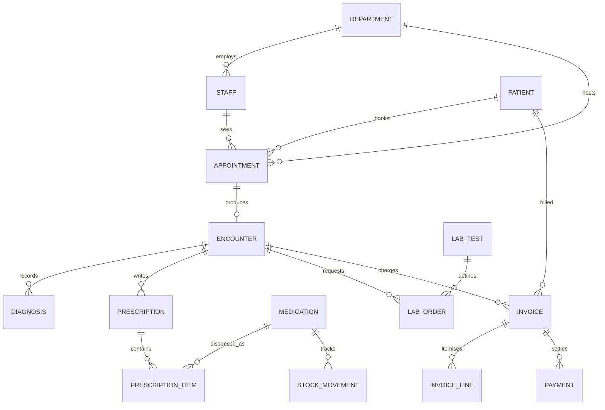

# Entity-relationship diagram

**Student:** Asiya Ya'u (2026/A/MIT/0763)

The drawing is in [er-diagram.svg](er-diagram.svg). The cardinalities are:

An appointment may exist with no encounter yet, which is why the encounter side is optional. A prescription item always names one medicine. A payment always belongs to one invoice. Clinical notes that do not have a fixed shape are not forced into this diagram; they are the document collection in Portfolio 4, joined back by `encounter_id` and `hospital_no`.
